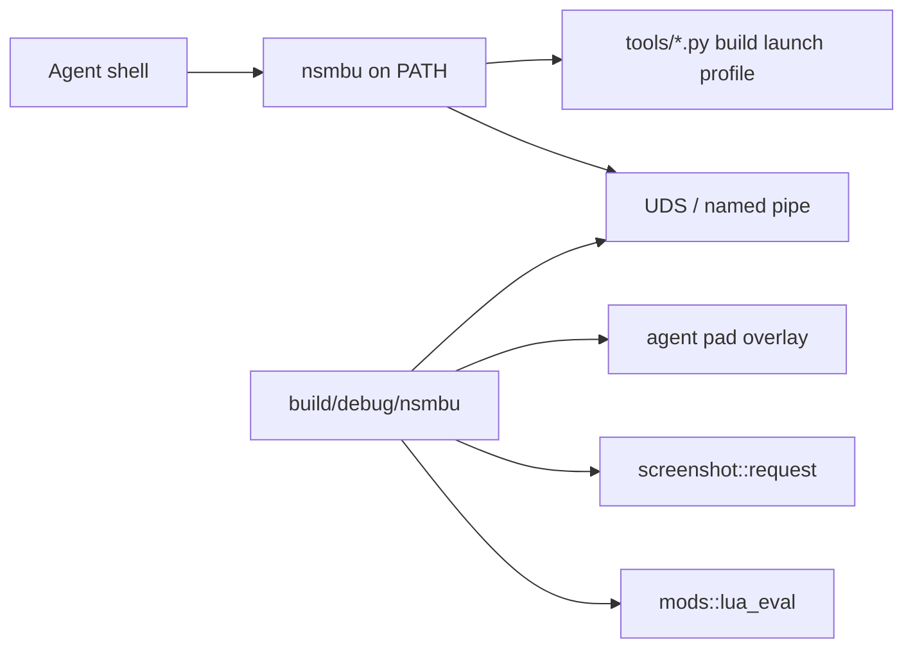

# `nsmbu` developer and agent CLI

## Goals

Ship a native TypeScript CLI under `tools/cli/` run with Node 24 type stripping (`node …/*.ts`, erasable TypeScript only; `tsc --noEmit` for checks).
Expose it globally as `nsmbu` via `npm link` from `tools/cli/`.
Agents and automation always invoke `nsmbu …` on `PATH`.
Add an agent-browser-like control loop for a running game: wait/status, press/stick pulses, screenshot, quit.

Keep `NSMBU_RECORD_INPUT` / `NSMBU_REPLAY_INPUT` and `replays/<name>.replay` for complex timelines (see [automation.md](automation.md)).
The live CLI is for short interactive pulses and observation, not a replacement for long pad logs.

Only one game instance is supported.
The process is too heavy to run more than one, so there is no `--session` flag and no multi-instance control.

## Install

Node 24 or newer.

```
cd tools/cli && npm link
```

After that, use the global `nsmbu` on `PATH`.
Do not invoke `node tools/cli/bin/nsmbu.ts` or a repo-root shim.

### Fish completions

```
nsmbu completion fish --install
```

That writes `~/.config/fish/completions/nsmbu.fish`.
New fish sessions load it automatically.
In an already-open shell, run `source ~/.config/fish/completions/nsmbu.fish`.
To print the script instead of installing: `nsmbu completion fish`.

## Architecture



### Transport

Unix domain socket on Linux and macOS; named pipe on Windows.
Fixed path under `.tmp/agent/` (socket, pid, optional log) for the single running instance.
The game opens the listener when started through `nsmbu open` (or `launch --agent`).
Protocol: newline-delimited JSON request/response.
No HTTP server.

### Input model

Live pad overlay merged in `input::read()` in `runtime/src/platform/input_sdl.cpp` (same layering idea as `mods::lua_press`).
Hold bits or stick axes until released or until a short pulse duration (default about 20 frames).
Does not write replay files.
`nsmbu record` and `nsmbu replay` keep using env and launch as today.

### Observation

Commands call into existing APIs: `render::frame_count()`, `interp::logic_steps()`, optional `interp::player_snapshot()`, `screenshot::request()` / dump path under `.tmp/agent/`.

## Dev commands

Package name and binary name are `nsmbu`.
Entry: `tools/cli/bin/nsmbu.ts` with shebang / `package.json` `"bin":{"nsmbu":"…"}`, `"type":"module"`, `"engines":{"node":">=24"}`.

The CLI exports `NSMBU_USER_DIR=<repo>/nsmbu` on every dev command (same layout as before).

| Command | Role |
| --- | --- |
| `nsmbu build` / `build --release` / `build --sanitizer` | `tools/build/build.py` |
| `nsmbu launch` (+ `--no-debug`, `--trace`, `--gdb`, `--lldb`) | `tools/run/launch.py` |
| `nsmbu crash` | launch with `NSMBU_TEST_HOST_CRASH=1` to exercise the Report crash dialog |
| `nsmbu wine` (+ `--no-debug`, `--trace`) | cross-build `build/windows/nsmbu.exe` then `tools/run/launch.py --wine` |
| `nsmbu run` / `run --release` | build then launch |
| `nsmbu extract` | `tools/disc/extract.py` |
| `nsmbu save <save.dat\|save.json> [output] [--output PATH]` | convert `rp_savedata.dat` to JSON and back |
| `nsmbu record <course> [name]` / `replay [--release] [--uncapped] [--no-exit-on-input] [--exit-at N] [--log PATH] <name>` | env + launch (see [automation.md](automation.md)) |
| `nsmbu profile` / `perf` | profiling helpers |
| `nsmbu installer [--version VERSION]` | builds this Linux host's GitHub Release folder (the zip contents) at `build/installer` with the release workflow's pinned zig toolchain, then opens that folder's setup window; does not publish |
| `nsmbu lint` / `recomp` | TypeScript mod build, recomp only |
| `nsmbu scripted <name>` | wraps `tools/run/scripted-run.sh` |
| `nsmbu test [name…]` | boots the game and runs the playtests in [automation.md](automation.md) |

Run `nsmbu` with no arguments (or `--help`) for the full list.

### Save data

`nsmbu save` converts `rp_savedata.dat` to JSON and back.
Pass the save file to produce JSON next to it; pass the JSON to produce a `.dat` file.

```
nsmbu save .tmp/menutr2/save/common/rp_savedata.dat
nsmbu save .tmp/menutr2/save/common/rp_savedata.json
nsmbu save in.dat out.json
```

The JSON keeps every unknown and padding byte, so a JSON to `.dat` to JSON round trip is lossless.
No CRC32 fields appear in the JSON; the structural checksums are recomputed when writing the `.dat` file so the game still accepts it.
Non-finite `f32` values (star coin coordinates) are written as `0x`-prefixed 32-bit hex.

## Agent control

Commands talk to the single running game over the fixed control socket.

- `nsmbu open [slot|course|course-file] […]` — ensure binary, spawn the game with agent control enabled, wait until the socket accepts.
  A course file is a `course_res_pack` archive, such as `game/content/Common/course_res_pack/1-27.szs`, and starts that course the same way as `1-27`.
  Refuse if a game is already running.
- `nsmbu status` — one line from the guest thread: frame, logic step, pid, scene name, whether the world map or a course task is alive, course pack, entering pack when it differs, save file, map checkpoint, map node and world, and the player snapshot or `player=none`.
  Fields that are not ready are omitted.
- `nsmbu press A` / `press 8000` — short pulse (configurable frames).
- `nsmbu stick <x> <y> [--frames N]` / `rstick …`
- `nsmbu screenshot [path]` — wait until PNG written; print path.
- `nsmbu eval [code] [--file PATH] [--timeout MS]` — run Lua on the game thread and print its output.
  The state persists between calls, has the mod SDK as the global `nsmbu`, and reads code from stdin when no code or file is given.
  `--timeout` limits execution time in milliseconds (default 5000) so a runaway loop errors instead of freezing the game.
- `nsmbu wait --frame N` / `wait --step N` / `wait --scene NAME` — poll `status` until every bound is met.
  `--scene` matches the scene name (`Boot`, `Flow`, `FileSelect`, `SaveSelect`, `Title`, `Menu`, `Map`, `CourseTask`, `CourseSelect`).
  A timeout includes the last status line.
- `nsmbu quit` / `close` — graceful quit and tear down control files under `.tmp/agent/`.

These commands block until their work is done: `open` waits for the socket, `press` / `stick` hold for their frames, `screenshot` waits for the PNG, `eval` waits for the game thread to run the code, `status` waits for the guest thread to read the scene, and `wait` polls until the frame, step, or scene bound.
Do not add shell sleeps between control commands.
Use `wait --step N` or `wait --scene NAME` when the next action needs guest progress.

Headless boots that use `tools/run/scripted-run.sh` stay available as `nsmbu scripted <name>` so agents can still do exit-at-frame dumps without a second path.
Live `open` / `press` / `screenshot` is the interactive loop.

## Runtime work

New small module (for example `runtime/src/agent/agent_ctl.cpp` and header):

- Start listener when `NSMBU_AGENT_SOCK` (or equivalent `env::` entry in `runtime/src/core/env.h`) is set by the CLI.
- Accept one local client connection at a time (or multiplex simple request IDs).
- Apply pad overlay each `input::read()`.
- Service screenshot and quit on the render/host thread safely (queue commands, apply on known threads — same discipline as overlay / `hostui::post`).
- Service `status` and `eval` on the guest thread next to `mods::packages::frame()`, so reads and writes see game state at the same point as mods.
  `status` also runs on a held frame so a stuck logic step still answers.
  Keep one persistent `lua_mod` instance for the console and reuse `mods::lua_eval` from `runtime/src/mods/lua_eval.cpp`.
- Wire quit to the existing SDL quit path.

No change to the replay file format or `NSMBU_PRESS` start-only tables except coexistence (agent overlay OR’ed with scripted/replay as documented).

## Docs and agent skills

`CONTRIBUTING.md`, `docs/nsmbu/port.md`, `docs/automation.md`, `AGENTS.md`, and `.agents/skills/build/SKILL.md` use `nsmbu …` for CLI invocations.
`.agents/skills/nsmbu/SKILL.md` documents the single-instance control loop: read `nsmbu status` before `eval`, then `press`, `wait --scene`, and `close`.
Complex input stays on `record` / `replay`.

## Implementation notes

The CLI shells out to existing Python tools for build, launch, and profile; do not reimplement CMake in TypeScript.
TypeScript: erasable syntax only (`erasableSyntaxOnly` in `tools/cli/tsconfig.json`); imports use `.ts` extensions.
Control state for the one instance lives under `.tmp/agent/` (gitignored via existing `.tmp/`).
Global install is `npm link` from `tools/cli/`; do not add a repo-root wrapper script.
No `--session` and no multi-game support.
