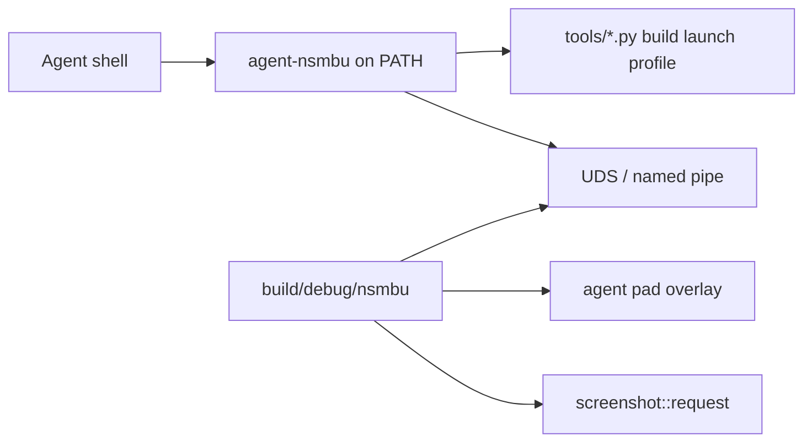

# `agent-nsmbu` developer and agent CLI

## Goals

Ship a native TypeScript CLI under `cli/` run with Node 24 type stripping (`node …/*.ts`, erasable TypeScript only; `tsc --noEmit` for checks).
Expose it globally as `agent-nsmbu` via `npm link` from `cli/`.
Agents and automation always invoke `agent-nsmbu …` on `PATH`.
Add an agent-browser-like control loop for a running game: wait/status, press/stick pulses, screenshot, quit.

Keep `NSMBU_RECORD_INPUT` / `NSMBU_REPLAY_INPUT` and `replays/<course>.replay` for complex timelines (see [automation.md](automation.md)).
The live CLI is for short interactive pulses and observation, not a replacement for long pad logs.

Only one game instance is supported.
The process is too heavy to run more than one, so there is no `--session` flag and no multi-instance control.

## Install

Node 24 or newer.

```
cd cli && npm link
```

After that, use the global `agent-nsmbu` on `PATH`.
Do not invoke `node cli/bin/agent-nsmbu.ts` or a repo-root shim.

## Architecture



### Transport

Unix domain socket on Linux and macOS; named pipe on Windows.
Fixed path under `.tmp/agent/` (socket, pid, optional log) for the single running instance.
The game opens the listener when started through `agent-nsmbu open` (or `launch --agent`).
Protocol: newline-delimited JSON request/response.
No HTTP server.

### Input model

Live pad overlay merged in `input::read()` in `runtime/src/platform/input_sdl.cpp` (same layering idea as `mods::luau_press`).
Hold bits or stick axes until released or until a short pulse duration (default about 20 frames).
Does not write replay files.
`agent-nsmbu record` and `agent-nsmbu replay` keep using env and launch as today.

### Observation

Commands call into existing APIs: `render::frame_count()`, `interp::logic_steps()`, optional `interp::player_snapshot()`, `screenshot::request()` / dump path under `.tmp/agent/`.

## Dev commands

Package name and binary name are `agent-nsmbu`.
Entry: `cli/bin/agent-nsmbu.ts` with shebang / `package.json` `"bin":{"agent-nsmbu":"…"}`, `"type":"module"`, `"engines":{"node":">=24"}`.

The CLI exports `NSMBU_USER_DIR=<repo>/nsmbu` on every dev command (same layout as before).

| Command | Role |
| --- | --- |
| `agent-nsmbu build` / `build --release` / `build --sanitizer` | `tools/build.py` |
| `agent-nsmbu launch` (+ `--no-debug`, `--trace`, `--gdb`, `--lldb`) | `tools/launch.py` |
| `agent-nsmbu run` / `run --release` | build then launch |
| `agent-nsmbu extract` | `tools/extract.py` |
| `agent-nsmbu record <course>` / `replay [--release] [--uncapped] [--exit-at N] [--log PATH] <course>` | env + launch (see [automation.md](automation.md)) |
| `agent-nsmbu profile` / `perf` | profiling helpers |
| `agent-nsmbu installer` / `lint` / `recomp` | installer, Luau lint, recomp only |
| `agent-nsmbu scripted <name>` | wraps `tools/scripted-run.sh` |

Run `agent-nsmbu` with no arguments (or `--help`) for the full list.

## Agent control

Commands talk to the single running game over the fixed control socket.

- `agent-nsmbu open [slot|course] […]` — ensure binary, spawn the game with agent control enabled, wait until the socket accepts.
  Refuse if a game is already running.
- `agent-nsmbu status` — frame, logic step, player snapshot when in course, pid.
- `agent-nsmbu press A` / `press 8000` — short pulse (configurable frames).
- `agent-nsmbu stick <x> <y> [--frames N]` / `rstick …`
- `agent-nsmbu screenshot [path]` — wait until PNG written; print path.
- `agent-nsmbu wait --frame N` / `wait --step N` — poll `status` until bound.
- `agent-nsmbu quit` / `close` — graceful quit and tear down control files under `.tmp/agent/`.

Headless boots that use `tools/scripted-run.sh` stay available as `agent-nsmbu scripted <name>` so agents can still do exit-at-frame dumps without a second path.
Live `open` / `press` / `screenshot` is the interactive loop.

## Runtime work

New small module (for example `runtime/src/agent_ctl.cpp` and header):

- Start listener when `NSMBU_AGENT_SOCK` (or equivalent `env::` entry in `runtime/src/env.h`) is set by the CLI.
- Accept one local client connection at a time (or multiplex simple request IDs).
- Apply pad overlay each `input::read()`.
- Service screenshot, status, and quit on the render/host thread safely (queue commands, apply on known threads — same discipline as overlay / `hostui::post`).
- Wire quit to the existing SDL quit path.

No change to the replay file format or `NSMBU_PRESS` start-only tables except coexistence (agent overlay OR’ed with scripted/replay as documented).

## Docs and agent skills

`README.md`, `docs/nsmbu.md`, `docs/automation.md`, `AGENTS.md`, and `.agents/skills/build/SKILL.md` use `agent-nsmbu …` for CLI invocations.
`.agents/skills/agent-nsmbu/SKILL.md` documents install, the single-instance control loop (`open` → `status` / `screenshot` → `press` → `wait` → `close`), and that complex input stays on `record` / `replay`.

## Implementation notes

The CLI shells out to existing Python tools for build, launch, and profile; do not reimplement CMake in TypeScript.
TypeScript: erasable syntax only (`erasableSyntaxOnly` in `cli/tsconfig.json`); imports use `.ts` extensions.
Control state for the one instance lives under `.tmp/agent/` (gitignored via existing `.tmp/`).
Global install is `npm link` from `cli/`; do not add a repo-root wrapper script.
No `--session` and no multi-game support.
