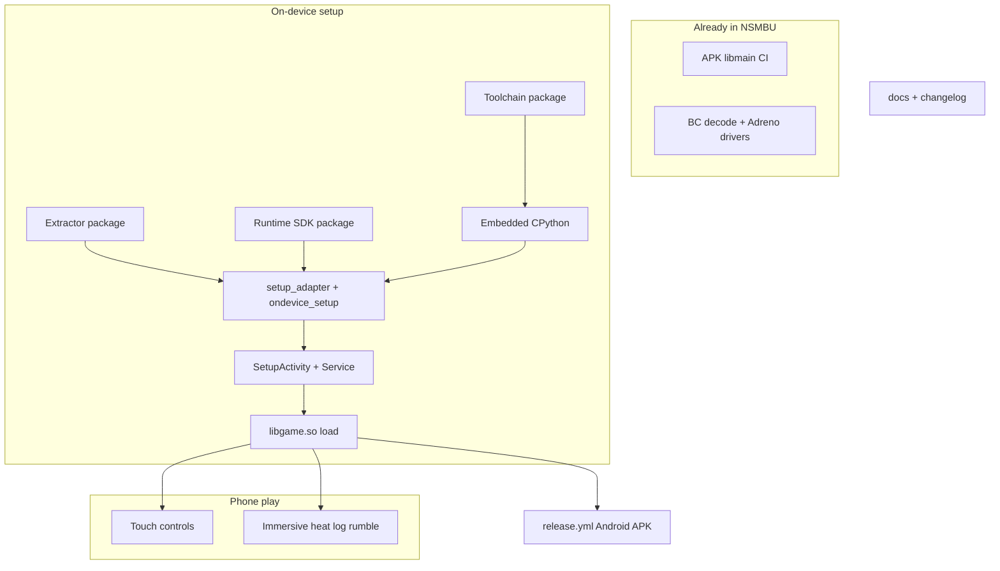

# Port WWHD Android (no dual-screen)

Source of truth: [`.tmp/ZeldaWWHDRecomp`](../../.tmp/ZeldaWWHDRecomp).
Target: this repo’s existing Android APK path ([`android/`](../../android/), [`runtime/src/gfx/vulkan/android_driver.*`](../../runtime/src/gfx/vulkan/android_driver.cpp)).

Keep / already present: BC decode, Adreno custom drivers, display refresh, perf hints, save import/export, shader-cache checkpointing, CI [`android.yml`](../../.github/workflows/android.yml).
Exclude entirely: `GamePadDisplay`, `FoldLayout`, `SavedSecondScreen`, `android_isolated_presenter`, `android_shared_image`, dual-display smokes/workflows, WWHD-only gameplay (gyro aim, 40 fps mode, code-mods / cheats / guest-tools catalogue).
Cross-cutting renames: `org.wwhdrecomp.wwhd` → `org.nsmbrecomp.nsmbu`; `WWHD_*` → existing `NSMBU_*` ([`runtime/src/core/env.h`](../../runtime/src/core/env.h)); `wwhd`/`libwwhdpython`/`wwhd_native` → `nsmbu`/`libnsmbupython`/`nsmbu_native`; game identity via `code/red-pro2.rpx` + [`tools/recomp/builds.py`](../../tools/recomp/builds.py).
Delivery: one commit per package below (message + Unreleased changelog line each).
Later packages depend on earlier setup ones as noted.

## Commit sequence

### 1. Android-hosted LLVM toolchain packaging

- Port [`tools/android/build_toolchain.py`](../../.tmp/ZeldaWWHDRecomp/tools/android/build_toolchain.py), [`package_toolchain.py`](../../.tmp/ZeldaWWHDRecomp/tools/android/package_toolchain.py), [`.github/actions/android-compiler`](../../.tmp/ZeldaWWHDRecomp/.github/actions/android-compiler), and a trimmed [`android-toolchain.yml`](../../.tmp/ZeldaWWHDRecomp/.github/workflows/android-toolchain.yml).
- Tests: `test_build_toolchain.py`, `test_package_toolchain.py`.

### 2. Extractor packaging

- Port [`package_extractor.py`](../../.tmp/ZeldaWWHDRecomp/tools/android/package_extractor.py) + `AndroidExtractor.java` → `org.nsmbrecomp.nsmbu`.
- Wire to existing desktop `nsmbu-extract` / CMake Android build of the extract helper.
- Preserve NSMBU extract semantics (folder / archive / WUD+keys + **update folder** from [`extract_game(..., update_dir=)`](../../tools/installer/setup.py)).
- Tests: `test_package_extractor.py`, `test_extract_adapter.py`.

### 3. Runtime SDK package for on-device link

- Port [`package_runtime.py`](../../.tmp/ZeldaWWHDRecomp/tools/android/package_runtime.py).
- Extend [`link_game`](../../tools/installer/setup.py) with WWHD-style `recipe=` / `glue=` so Android links `libgame.so` without shipping guest C in the SDK.
- Update [`tools/release/package.py`](../../tools/release/package.py) / SDK manifest for Android link stanza.
- Tests: `test_package_runtime.py`; extend installer/SDK package tests.

### 4. Native build layout for setup app

- Align [`android/build_native.sh`](../../android/build_native.sh) with WWHD: multi-ABI (`ABI=`), stub `GEN_DIR`, optional `nsmbu_yaz0` / `libyaz0.so` for shader prep (CMake).
- Keep adrenotools hook `.so` packaging.
- CI still builds; later commits stop shipping player `libmain.so` in release APKs.

### 5. Embedded CPython + resource verify

- Port `android/python/{bridge,launcher,process}.c`, [`prepare_python.py`](../../.tmp/ZeldaWWHDRecomp/tools/android/prepare_python.py), `EmbeddedPython.java`, `ResourceVerifier.java`, `ResourceCacheCleanup.java`.
- Brand `libnsmbupython` / `PyInit_nsmbu_native`; zip includes NSMBU `tools/installer`, `tools/recomp`, `tools/android/*.py`, shader helpers — not WWHD paths.
- Tests: `test_prepare_python.py`, `test_native_process.py`, embedding smokes.

### 6. Durable setup adapter

- Port [`setup_adapter.py`](../../.tmp/ZeldaWWHDRecomp/tools/android/setup_adapter.py), [`native_process.py`](../../.tmp/ZeldaWWHDRecomp/tools/android/native_process.py), [`android_fixture.py`](../../.tmp/ZeldaWWHDRecomp/tools/recomp/android_fixture.py).
- Call NSMBU `setup.py` extract/translate/compile/link; embed `recomp.py` via `runpy` with **4-arg** argv (no `--mod-hooks` unless `NSMBU_RECOMP_MOD_HOOKS`); plumb `update_dir`.
- Do **not** invoke desktop `main()` install (destructive).
- Tests: `test_setup_adapter.py`, fixture digests for synthetic RPX.

### 7. `ondevice_setup.py` job runner

- Port [`ondevice_setup.py`](../../.tmp/ZeldaWWHDRecomp/tools/android/ondevice_setup.py): lock → extract/folder → translate → compile → link → activate; versioned checkpoints; cancel process groups.
- Shader stage can stub/`skip` until commit 9; env `NSMBU_YAZ0_LIB` / `NSMBU_HEADSTART`.
- Drop `code_mods` job field.
- Tests: `test_ondevice_setup.py`, pause/key FD tests.

### 8. Gradle wiring for setup packages

- Extend [`android/app/build.gradle`](../../android/app/build.gradle) from WWHD: `nsmbuPythonDir` / `nsmbuToolchainDir` / `nsmbuExtractorDir`, signing `NSMBU_KEYSTORE_*`, `verifyReleasePython` (reject debug fixtures).
- No `androidx.window` (fold / dual-screen only).

### 9. Shader prebuild stage

- Port [`tools/installer/shader_prebuild.py`](../../.tmp/ZeldaWWHDRecomp/tools/installer/shader_prebuild.py), [`shader_prebuild_android.py`](../../.tmp/ZeldaWWHDRecomp/tools/android/shader_prebuild_android.py); hook into `ondevice_setup`.
- Generate/maintain NSMBU `tools/shadercache/template.bin` (code-free) using [`tools/shader/shaderprep.py`](../../tools/shader/shaderprep.py).
- Optional `ShaderPrepareActivity` if WWHD’s rebuild UX is needed.
- Tests: adapted `test_shader_prebuild.py`.

### 10. Setup UI + foreground service

- Port Setup* Java (Activity, Service, Store, Policy, Recovery, Picker, Import, FolderCheck, KeyAccess, JobCleanup, Presentation **progress UI only**), plus `AndroidToolchain`, strings, FGS/wake/notification permissions in [`AndroidManifest.xml`](../../android/app/src/main/AndroidManifest.xml).
- MAIN launcher → `SetupActivity`; game activity no longer the launcher.
- Include NSMBU update-folder import where desktop setup supports it.
- Tests: JVM `Setup*Test` / `Resource*Test`; Python `setup_*_smoke.py`, `picker_smoke.py`.
- **Skip** Fold/SavedSecondScreen tests.

### 11. Dynamic `libgame.so` load

- Port `AndroidGame.java` + merge relevant pieces of `WwhdActivity` into [`NsmbuActivity.java`](../../android/app/src/main/java/org/nsmbrecomp/nsmbu/NsmbuActivity.java): load activated library, `--game` / config dirs via `AndroidUserDirectories`, upgrade crash reports toward `CrashReports` / `SystemExitReports`.
- Release/setup APK must **not** require bundled player `libmain.so` (CI stub APK path can remain separately).
- Tests: `runtime_smoke.py`, `setup_build_smoke.py`.

### 12. Phone UX polish (single screen)

- Immersive fullscreen / cutout / Back→settings (`ControllerHintPolicy`).
- `LogShare.java`, `PhoneRumble.java` + JNI, `quitApp` on renderer shutdown.
- `GameFilesProvider.java`, `res/xml/game_mode_config.xml`.
- Port [`heat_guard.h`](../../.tmp/ZeldaWWHDRecomp/runtime/src/platform/heat_guard.h) + `HeatGuardDevice.java`; replace fixed thermal thresholds in [`perf_hint.cpp`](../../runtime/src/platform/perf_hint.cpp) with policy + `NSMBU_HEAT_GUARD`.
- Tests: `PhoneRumbleTest.java`, `heat_guard_test.cpp`, `HeatGuardDeviceTest.java`, SystemExit* tests.

### 13. On-screen touch controls

- Port [`touch_pad.cpp`](../../.tmp/ZeldaWWHDRecomp/runtime/src/platform/touch_pad.cpp), `touch_face.h` / `touch_buttons.h`, `TouchControls.java`, `TouchLayout.java`, `TgaImage.java`; CMake `RUNTIME_SOURCES` for Android.
- Wire overlay in `NsmbuActivity`; hide when a physical controller is connected; map buttons to NSMBU bindings (not WWHD-specific actions).
- **No** GamePad secondary-display coordinate path.
- Tests: any WWHD host touch tests that are display-agnostic; add a playtest case under `tools/cli/src/playtest/cases/` if the harness can drive it, otherwise document manual + Java unit coverage.

### 14. Release Android APK

- Port WWHD `release.yml` `android` + compiler-cache jobs: package toolchain/runtime/python/extractor, assemble signed APK, **remove** `libmain.so` before assemble, run [`tools/release/guard.py`](../../tools/release/guard.py).
- Artifact naming `NSMBU-*-android-arm64.apk` (and x86_64 if multi-ABI).
- Keep existing [`android.yml`](../../.github/workflows/android.yml) as stub/CI validation; evolve it toward setup-package verification once packages land.

### 15. Docs

- Add player/engineer docs adapted from WWHD [`docs/android.md`](../../.tmp/ZeldaWWHDRecomp/docs/android.md) / [`android-implementation.md`](../../.tmp/ZeldaWWHDRecomp/docs/android-implementation.md) with dual-display chapters removed.
- Extend [`docs/android-device-checklist.md`](../android-device-checklist.md); Unreleased changelog entries accumulate per commit (per `AGENTS.md`).

## Adaptation rules while porting

- Prefer copy-then-rename from `.tmp/ZeldaWWHDRecomp`, then thin edits for NSMBU paths — do not reimplement the durable coordinator from scratch.
- Never transplant a second recompiler; only hosting/GPU/UX patterns ([`docs/android-fork-reuse.md`](../../.tmp/ZeldaWWHDRecomp/docs/android-fork-reuse.md) intent).
- Desktop installer behavior stays unchanged for PC users; Android uses the adapter only.
- Each commit should include its automated tests from the WWHD `tools/android/test_*.py` / JVM suite where applicable.
- Match existing NSMBU style (4 spaces, brace on same line, no new narrating comments).

## Out of scope (explicit)

- Dual-screen / fold Presentation host and isolated Vulkan presenter.
- WWHD gyro aiming, 40 fps display mode, Android code-mods UI.
- Publishing store listing / Play Console (signed release APK via GitHub Releases only).
