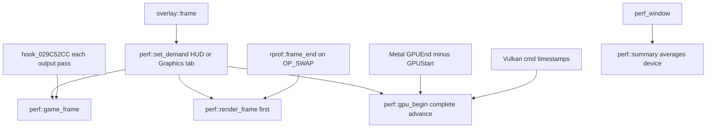

# Port FPS overlay and rebuild shader cache

## Goal

Match the Zelda WW HD overlay (averages, GPU/device, Game/Render CPU, GPU interval, footer) and add Rebuild shader cache, adapted to NSMBU.

Source reference: `.tmp/ZeldaWWHDRecomp`.

## Todos

- Add `perf_metrics.{h,cpp}` + unit test; wire `game_frame` / `render_frame` / Vulkan+Metal GPU interval + `set_demand`
- Upgrade `perf_window` and Copy report; Reset calls `perf::reset`; keep lag-breakdown detail
- Add `shader_rebuild.h`, Graphics/menu button, setup Precompile wipe on `rebuild.request` + installer test
- Append Unreleased CHANGELOG notes for overlay and rebuild shader cache

## A. Performance overlay

### New module

- Add [runtime/src/perf_metrics.h](../../runtime/src/perf_metrics.h) and [runtime/src/perf_metrics.cpp](../../runtime/src/perf_metrics.cpp) from Zelda (rolling Game/Render/GPU metrics, demand-gated).
- CMake already GLOBs `runtime/src/*.cpp`.
- Port Zelda `perf_metrics_test` to [runtime/test/perf_metrics_test.cpp](../../runtime/test/perf_metrics_test.cpp) and register like `perf_average_test` in [CMakeLists.txt](../../CMakeLists.txt).

### Wire sampling

- [runtime/src/hooks/interp.cpp](../../runtime/src/hooks/interp.cpp): `perf::game_frame()` at start of `hook_029C52CC`.
- [runtime/src/gfx/render_prof.cpp](../../runtime/src/gfx/render_prof.cpp): `perf::render_frame()` at start of `frame_end`, before the `enabled()` early return.
- Vulkan: port Zelda overlay query ring into [runtime/src/gfx/vulkan/backend.cpp](../../runtime/src/gfx/vulkan/backend.cpp) (reuse existing timestamp helpers; keep overlay queries demand-gated and separate from `NSMBU_VK_GPU_TIMESTAMPS`).
- Metal: wire `perf::gpu_*` in [runtime/src/gfx/metal/metal_main.mm](../../runtime/src/gfx/metal/metal_main.mm) beside existing `track_gpu_time`.

### HUD and Settings in [runtime/src/overlay/overlay.cpp](../../runtime/src/overlay/overlay.cpp)

- Expand `perf_window`: average fps + logic steps/s (`g_average`, already sampled), device line, `perf::summary()`, graph, disabled footer (api, scale, mode), paced in-between share.
  Keep optional lag breakdown under the existing detail checkbox.
- Slow-motion hint adapted for 60 logic steps/s (Zelda thresholds are for 30).
- `perf::set_demand(perf_shown(), Graphics tab open)`; Reset also calls `perf::reset()`.
- Enrich Copy performance report with FPS/average/worst + `perf::summary()` plus existing rprof/reporthdr (skip Zelda-only dynres/render_objects).

## B. Rebuild shader cache (adapted)

Do not port Zelda generation/`shader_prebuild.h`.
NSMBU warms via setup Precompile shaders.

- Thin [runtime/src/gfx/shader_rebuild.h](../../runtime/src/gfx/shader_rebuild.h): marker at `{config_dir}/shader-rebuild/rebuild.request`, `request_rebuild` / `requested` / `setup_hint` pointing at Precompile shaders; wipe helper for setup only.
- Graphics tab top: Shader cache section + Rebuild button (Zelda `shader_cache_section` pattern).
- macOS: same action in [runtime/src/gfx/metal/menu.mm](../../runtime/src/gfx/metal/menu.mm).
- [tools/installer/setup.py](../../tools/installer/setup.py): on Precompile, if marker exists, wipe `shadercache` then warm then remove marker; add assertion in [tools/installer/test_setup.py](../../tools/installer/test_setup.py).
- UI does not delete live in-memory caches mid-session.

## C. Changelog

- Unreleased bullets in [CHANGELOG.md](../../CHANGELOG.md) for richer overlay and rebuild control.

## Out of scope

- Zelda 30 fps / True 60 radios and full shader-prebuild generations.
